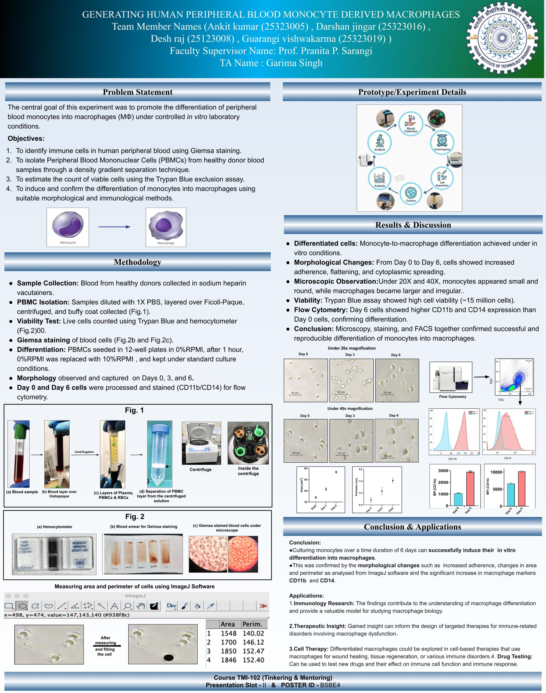
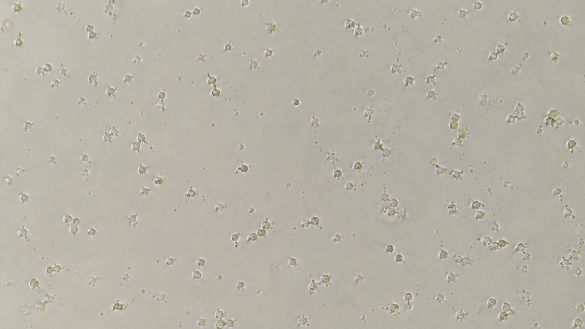
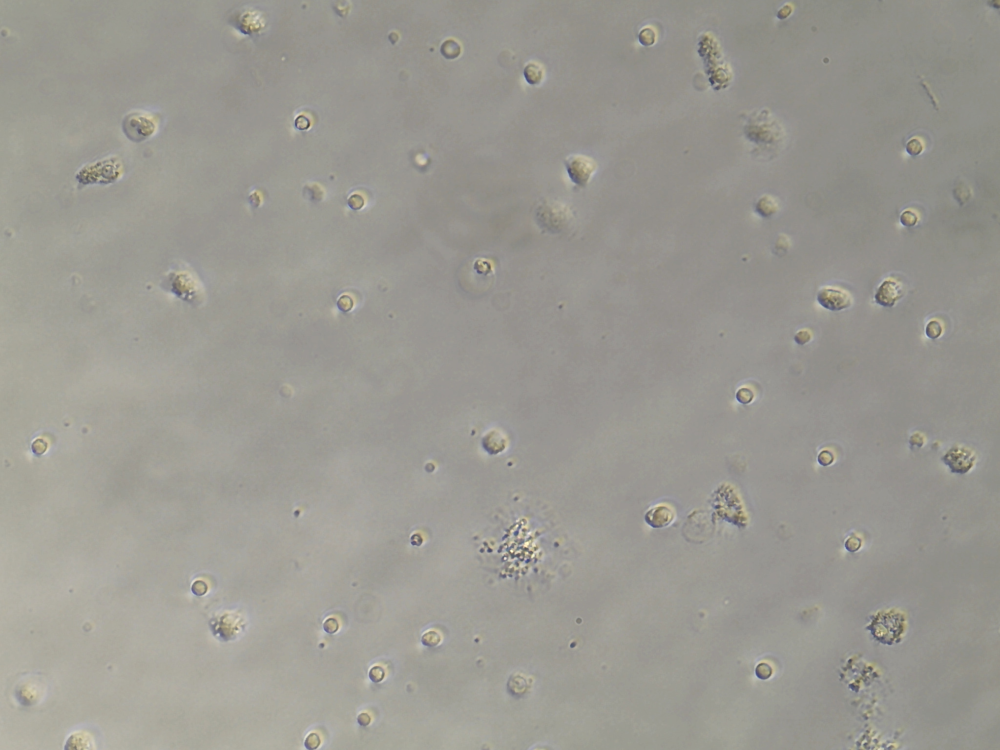
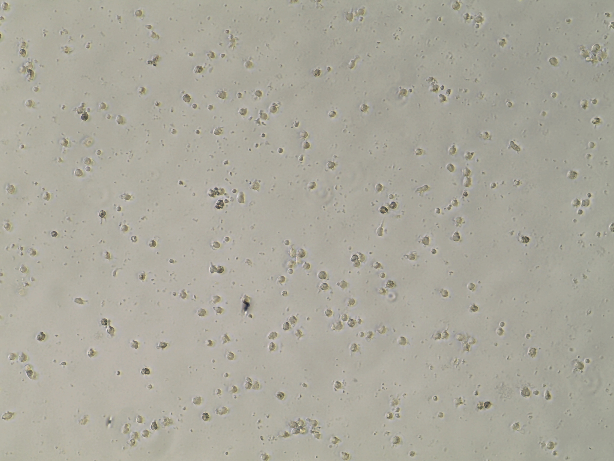
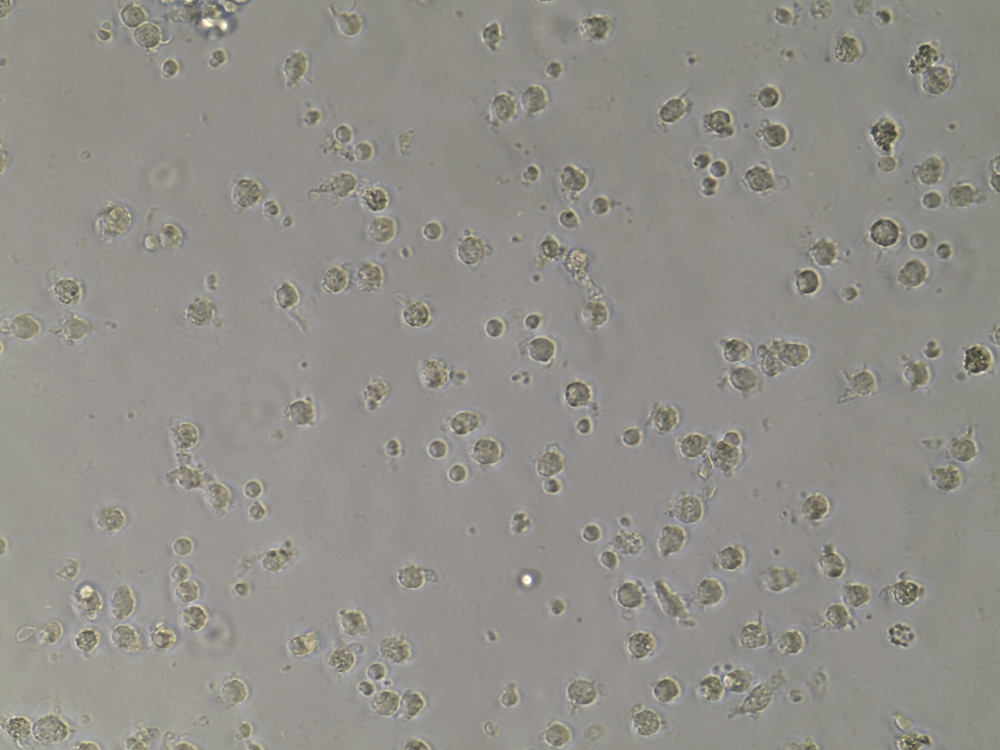
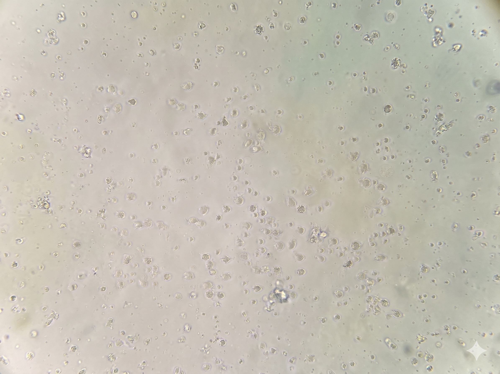
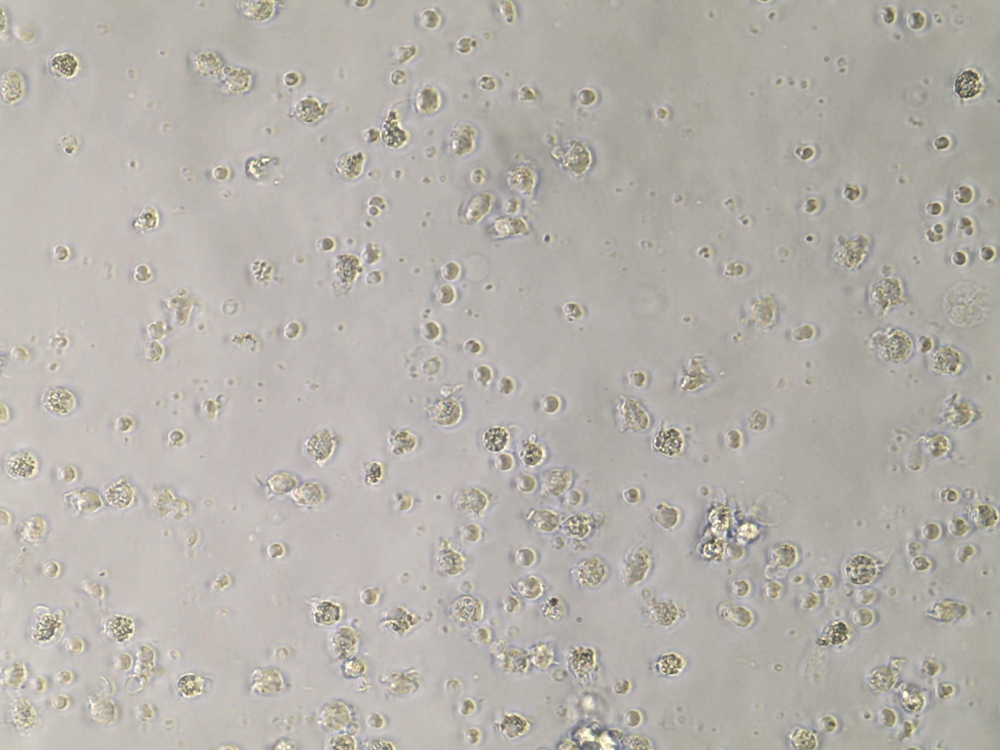

# Generation-of-Human-Peripheral-Blood-Monocyte-Derived-Macrophages-
An *in vitro* experimental workflow to isolate Peripheral Blood Mononuclear Cells (PBMCs) from human whole blood and induce monocyte-to-macrophage differentiation over a 6-day culture period. Differentiation was confirmed through brightfield microscopy (20x and 40x), **ImageJ** morphometric quantification (cell area and perimeter), and **Flow Cytometry (FACS)** surface marker profiling (**CD11b** and **CD14**).

---

## Project Poster


---

## Experimental Workflow & Methodology

1. **Sample Collection & PBMC Isolation:** Whole blood collected in sodium heparin vacutainers was diluted with **1X PBS** and layered over **Ficoll-Paque (Histopaque)**. Following density gradient centrifugation, the buffy coat PBMC layer was harvested[cite: 79].
2. **Cell Viability & Staining:** Viable cells were quantified via **Trypan Blue exclusion** using a hemocytometer (~15 million viable cells)[cite: 79], and blood smears were stained with **Giemsa** for baseline leukocyte identification[cite: 79].
3. **In Vitro Differentiation Culture:** PBMCs were seeded into 12-well plates in serum-free **0% RPMI**[cite: 79]. After 1 hour of monocyte adherence, media was replaced with **10% RPMI** and maintained under standard culture conditions for 6 days[cite: 79].
4. **Morphological & Immunological Validation:** Brightfield images were captured on **Days 0, 3, and 6** under **20x** and **40x** magnification, quantified using **ImageJ**, and analyzed via flow cytometry for **CD11b** and **CD14** upregulation[cite: 79].

---

## Morphological Progression (Day 0 → Day 6)

| Timepoint | 20x Magnification | 40x Magnification | Observed Cellular Morphology |
| :--- | :---: | :---: | :--- |
| **Day 0** *(Monocytes)* |  |  | Small, spherical, non-adherent peripheral monocytes |
| **Day 3** *(Differentiating)* |  |  | Early plate adherence, cell elongation, and initial cytoplasmic spreading |
| **Day 6** *(Macrophages)* |  |  | Large, firmly adherent, irregular/spread mature macrophage morphology |

---

## Quantitative Validation

### 1. ImageJ Morphometric Analysis
Single-cell boundary tracing and area/perimeter quantification in **ImageJ** confirmed significant cellular hypertrophy and spreading from Day 0 to Day 6[cite: 79]:

| Sample Cell ID | Measured Area (px²) | Measured Perimeter (px) |
| :---: | :---: | :---: |
| 1 | 1548 | 140.02 |
| 2 | 1700 | 146.12 |
| 3 | 1850 | 152.47 |
| 4 | 1846 | 152.40 |

### 2. Flow Cytometry (FACS) Surface Marker Expression
* **Markers Assayed:** `CD11b` and `CD14`[cite: 79]
* **Key Finding:** Day 6 differentiated cells exhibited substantial Mean Fluorescence Intensity (MFI) shifts and higher expression levels of both **CD11b** and **CD14** compared to Day 0 baseline monocytes, confirming successful macrophage maturation[cite: 79].

---

## Repository Structure
```text
human-pbmc-macrophage-differentiation/
├── Docs/
│   ├── cell-data.xlsx
│   ├── cell-info.csv
│   └── project-poster.jpg
├── Images/
│   ├── day_0/
│   │   ├── day0_20x.jpg
│   │   └── day0_40x.jpg
│   ├── day_3/
│   │   ├── day3_20x.jpg
│   │   └── day3_40x.jpg
│   └── day_6/
│       ├── day6_20x.jpg
│       └── day6_40x.jpg
├── Protocols/
│   └── differentiation_protocol.md
└── README.md
